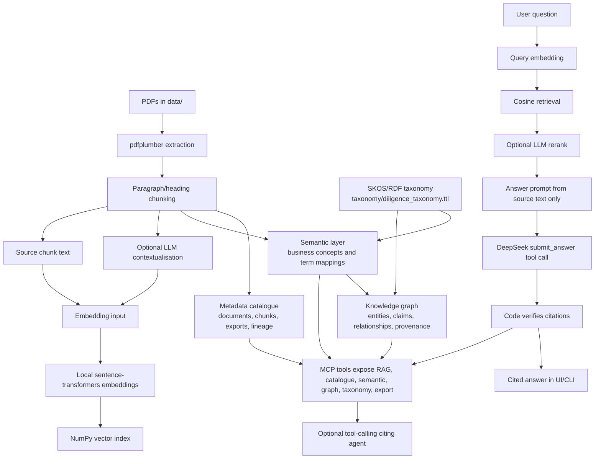

# Data Room Cited

Data Room Cited is a focused RAG prototype for commercial due diligence. It helps a consultant interrogate a small data room, get grounded answers, and see exactly where each cited claim came from.

The goal is not to automate diligence. The goal is to speed up the first pass through a data room while keeping the system honest about source coverage, missing evidence, and citation quality.

## Demo

[Watch the demo video](https://github.com/user-attachments/assets/a6287247-a55b-4740-93e6-9a4957c42f48)

## How To Run

Prerequisites:

- Windows PowerShell
- Python 3.11+ available for creating the virtual environment
- A DeepSeek API key
- Local PDF files placed in `data/`. The public repo keeps this folder empty and ignores `data/*.pdf`.

Create and activate the local environment:

```powershell
python -m venv .venv
.\.venv\Scripts\pip.exe install -r requirements.txt
```

Create `.env` from `.env.example`, then paste your key:

```env
DEEPSEEK_API_KEY=your_key_here
```

Smoke test DeepSeek:

```powershell
.\.venv\Scripts\python.exe scripts\smoke_deepseek.py
```

Build the local vector index without ingest-time contextualisation:

```powershell
.\.venv\Scripts\python.exe scripts\build_index.py --no-contextualize
```

Build the index with contextualisation:

```powershell
.\.venv\Scripts\python.exe scripts\build_index.py --contextualize
```

The same build step also refreshes the local metadata catalogue, semantic index, and knowledge graph in `index/`.

Run the small data-management eval harness:

```powershell
.\.venv\Scripts\python.exe scripts\evaluate_data_management.py
```

Ask from the CLI:

```powershell
.\.venv\Scripts\python.exe scripts\ask.py "What are the key contracts?"
```

Ask through the tool-calling citing agent:

```powershell
.\.venv\Scripts\python.exe scripts\agent_ask.py "What contract risks should I cite?"
```

Run the MCP server over stdio for an MCP-compatible client:

```powershell
.\.venv\Scripts\python.exe scripts\mcp_server.py
```

Validate the MCP server with MCP Inspector. On a machine with Node/npm on PATH, use:

```powershell
npx @modelcontextprotocol/inspector --cli .\.venv\Scripts\python.exe scripts\mcp_server.py --method tools/list --format json
```

In this workspace, global `npx` was not available, so the tested command used `pnpm dlx` with Node on `PATH`:

```powershell
pnpm dlx @modelcontextprotocol/inspector --cli .\.venv\Scripts\python.exe scripts\mcp_server.py --method tools/list --format json
```

For `search_data_room`, the Inspector smoke test below uses `semantic=false` so the one-shot MCP process does not spend the request window cold-loading the local embedding model. The app and agent still use semantic retrieval by default.

Run the Streamlit UI:

```powershell
.\.venv\Scripts\streamlit.exe run app.py
```

Open:

```text
http://localhost:8501
```

Consultant stress-test prompts are in [`docs/consultant_stress_tests.md`](docs/consultant_stress_tests.md).

## What It Does

1. Loads configuration from `.env` through `src/config.py`.
2. Reads PDFs from `data/` using `pdfplumber`.
3. Splits extracted text into paragraph/heading-aware chunks with page ranges and section titles.
4. Optionally asks DeepSeek to generate short retrieval-only context for each chunk at ingest time.
5. Embeds `chunk.context + chunk.text` when context exists; otherwise embeds `chunk.text`.
6. Stores chunks and embeddings in `index/chunks.json` and `index/embeddings.npy`.
7. At question time, embeds the user query locally with `BAAI/bge-small-en-v1.5`.
8. Retrieves candidate chunks with in-memory NumPy dot-product search over normalized vectors.
9. Optionally reranks candidates with DeepSeek, with graceful fallback to cosine retrieval.
10. For broad consultant questions, such as summaries, risks, missing information, inconsistencies, presentations, or readouts, uses the whole extracted corpus instead of only top-k retrieval.
11. Builds an answer prompt from source chunk text only, never generated context.
12. Forces DeepSeek to return a structured `submit_answer` function call.
13. Verifies every citation against retrieved `chunk.text` using whitespace-normalized, case-sensitive quote matching.
14. Retries once if citations fail and the answer is not already `insufficient`.
15. Displays citations with document, page range, section title, chunk ID, and quote.
16. Exposes retrieval, chunk inspection, citation verification, document coverage, rebuild, and export capabilities as MCP tools.
17. Provides an optional tool-calling citing agent that can call those tools before answering.
18. Builds a lightweight metadata catalogue for documents, chunks, exports, ownership placeholders, classification, sensitivity, quality status, and lineage.
19. Builds a semantic layer that maps source terms such as "customer", "ARR", and "termination" to canonical diligence concepts.
20. Builds a local NetworkX-backed knowledge graph with entities, concepts, claims, relationships, and source provenance.
21. Imports a small SKOS/Turtle taxonomy so controlled vocabulary resolution is testable without claiming a production PoolParty implementation.
22. Exposes catalogue, semantic, graph, taxonomy, and data-quality operations as MCP tools.
23. Includes a small deterministic eval harness for entity resolution, taxonomy resolution, graph search, and provenance checks.



## Key Decisions

- **Use DeepSeek directly instead of AWS Bedrock or APIs from Claude, OpenAI, or Gemini.** Bedrock model access added unnecessary complexity for this prototype, while DeepSeek's OpenAI-compatible endpoint made the demo buildable in one evening at a much lower cost.
- **Keep embeddings local.** `sentence-transformers` with `BAAI/bge-small-en-v1.5` is enough for this tiny corpus and avoids paying an external provider for every embedding call.
- **Use a local NumPy index.** There are only a handful of PDFs. A vector database would add operational complexity without improving the demo.
- **Use contextual retrieval only at ingest.** Generated context helps search, but final answers and citation checks use source text only.
- **Prefer verified citations over fluent answers.** The LLM can synthesize, but code decides whether a citation is acceptable.
- **Keep broad diligence questions whole-corpus.** A request like "prepare a diligence presentation" should not be bottlenecked by six nearest chunks.
- **Fail soft where possible.** Context generation and reranking are enhancements. If either fails, the system still builds or answers using vanilla embeddings/cosine retrieval.
- **Surface limits loudly.** If a PDF produces zero chunks, the system warns that OCR is needed instead of silently pretending it searched the document.
- **Use MCP as a capability boundary, not a rewrite.** The original RAG pipeline stays intact. MCP exposes high-level tools such as search, chunk inspection, citation verification, document coverage, rebuild, and export so an agent or external client can reuse the same trusted functions.
- **Add enterprise data-management concepts locally first.** The catalogue, semantic layer, taxonomy import, and graph are local JSON/NetworkX artifacts. That is deliberate: it demonstrates stewardship, lineage, controlled vocabulary, and graph-backed agent tools without pretending this prototype is a deployed enterprise catalogue or PoolParty/Neo4j service.

## MCP And Agent Layer

The server uses the documented Python SDK `FastMCP` API:

```python
from mcp.server.fastmcp import FastMCP
```

The validated SDK dependency is pinned as:

```text
mcp[cli]==1.29.0
```

The MCP layer turns the app's reliable internal capabilities into callable tools:

| Tool | Purpose |
|---|---|
| `list_documents` | Show PDFs in `data/` and whether each has indexed chunks |
| `search_data_room` | Run local semantic retrieval over the saved index; pass `semantic=false` for a quick lexical Inspector smoke test |
| `get_chunk` | Open one source chunk by `chunk_id` |
| `verify_citation` | Check that a quote appears in original source text for a chunk |
| `get_document_coverage` | Report indexed coverage and OCR/staleness warnings |
| `search_catalog` | Search catalogue assets by title, domain, classification, status, or chunk ID |
| `get_data_asset` | Inspect one catalogue asset |
| `get_asset_lineage` | Trace document-to-chunk-to-artifact lineage |
| `get_data_quality_status` | Summarize extraction status and data-quality warnings |
| `list_business_concepts` | List canonical diligence concepts and mention counts |
| `resolve_business_term` | Resolve source terminology to canonical business concepts |
| `search_by_entity` | Search semantic mentions and evidence |
| `get_entity_evidence` | Return source evidence for a concept or term |
| `search_entities` | Search graph entities, concepts, and claims |
| `get_entity_relationships` | Traverse graph relationships around an entity |
| `find_supporting_evidence` | Find claim nodes and source provenance for a topic |
| `find_conflicting_claims` | Surface heuristic contradiction candidates |
| `resolve_taxonomy_concept` | Resolve a term against the imported SKOS/Turtle taxonomy |
| `list_broader_concepts` | List broader controlled-vocabulary concepts |
| `list_related_concepts` | List related controlled-vocabulary concepts |
| `validate_entity_classification` | Validate a term against an expected taxonomy concept |
| `rebuild_index` | Rebuild chunks and embeddings from `data/*.pdf` |
| `export_powerpoint_outline` | Save a cited Markdown slide-outline artifact to `exports/` |
| `enterprise_connector_plan` | Document the planned SharePoint, Box, and CRM connector boundary |

The optional agent loop in `src/agent.py` uses DeepSeek tool calling over the same tool layer. It is intentionally separate from `src/rag.py`, so the original deterministic RAG flow remains available for the Streamlit UI and CLI.

The data-management additions are intentionally modest:

- The catalogue is a local JSON snapshot in `index/catalogue.json`.
- The semantic layer is defined in `semantic/business_concepts.json` and materialized to `index/semantic_index.json`.
- The graph is built with NetworkX and persisted to `index/knowledge_graph.json`.
- The taxonomy is a small SKOS/Turtle file in `taxonomy/diligence_taxonomy.ttl`.
- Every semantic mention, graph claim, and graph relationship keeps provenance back to document, page, chunk ID, and quote where available.

### Inspector Smoke-Test Samples

Tool discovery returned all eight registered tools:

```json
{
  "tools": [
    "list_documents",
    "search_data_room",
    "get_chunk",
    "verify_citation",
    "get_document_coverage",
    "rebuild_index",
    "export_powerpoint_outline",
    "enterprise_connector_plan"
  ]
}
```

`search_data_room` was called through Inspector in quick lexical mode:

```powershell
pnpm dlx @modelcontextprotocol/inspector --cli .\.venv\Scripts\python.exe scripts\mcp_server.py --method tools/call --tool-name search_data_room --tool-arg query="contract risks" --tool-arg top_k=2 --tool-arg semantic=false --format json
```

Sample response:

```json
{
  "query": "contract risks",
  "top_k": 2,
  "mode": "lexical",
  "results": [
    {
      "chunk_id": "01_Meridian_Analytics_Company_Overview-0001",
      "source": "01_Meridian_Analytics_Company_Overview.pdf pp.1-2, 4. Customers and commercial model",
      "score": 1.0
    }
  ]
}
```

`get_chunk` was called through Inspector:

```powershell
pnpm dlx @modelcontextprotocol/inspector --cli .\.venv\Scripts\python.exe scripts\mcp_server.py --method tools/call --tool-name get_chunk --tool-arg chunk_id=04_Meridian_Key_Contracts_Summary-0000 --format json
```

Sample response:

```json
{
  "found": true,
  "chunk": {
    "chunk_id": "04_Meridian_Key_Contracts_Summary-0000",
    "source": "04_Meridian_Key_Contracts_Summary.pdf p.1, Key Contracts Summary"
  }
}
```

`verify_citation` was called through Inspector:

```powershell
pnpm dlx @modelcontextprotocol/inspector --cli .\.venv\Scripts\python.exe scripts\mcp_server.py --method tools/call --tool-name verify_citation --tool-arg chunk_id=04_Meridian_Key_Contracts_Summary-0000 --tool-arg quote="Together these account for 61% of total ARR." --format json
```

Sample response:

```json
{
  "verified": true,
  "reason": "verified",
  "chunk_id": "04_Meridian_Key_Contracts_Summary-0000",
  "source": "04_Meridian_Key_Contracts_Summary.pdf p.1, Key Contracts Summary"
}
```

Example data-management tool calls:

```powershell
pnpm dlx @modelcontextprotocol/inspector --cli .\.venv\Scripts\python.exe scripts\mcp_server.py --method tools/call --tool-name get_data_quality_status --format json
```

```powershell
pnpm dlx @modelcontextprotocol/inspector --cli .\.venv\Scripts\python.exe scripts\mcp_server.py --method tools/call --tool-name resolve_business_term --tool-arg term=ARR --format json
```

```powershell
pnpm dlx @modelcontextprotocol/inspector --cli .\.venv\Scripts\python.exe scripts\mcp_server.py --method tools/call --tool-name search_entities --tool-arg query="Folium Stores" --tool-arg limit=1 --format json
```


## What It Deliberately Doesn't Do

- It does not OCR image-only or scanned PDFs. If a PDF produces no extractable text, indexing logs a warning naming the file and continues with the documents that did extract.
- It does not claim to read documents that produced zero chunks.
- It does not fine-tune a model.
- It does not use a production vector database.
- It does not preserve conversational memory as structured state.
- It does not produce a finished PowerPoint file. The MCP export tool saves a Markdown PowerPoint outline that a consultant can review.
- It does not guarantee that all risks are found. It gives a grounded first-pass view over extracted text.
- It does not treat generated contextualisation as source evidence.
- It does not show the past conversations.
- It does not implement live SharePoint, Box, or CRM connectors. The MCP tool documents that boundary as a production extension.
- It does not implement a production enterprise catalogue, semantic platform, Neo4j deployment, or PoolParty integration. It implements local, testable versions of those patterns.


## What I Would Do Differently With More Time

1. **OCR fallback for image-only PDFs.** Render scanned pages, run OCR, and feed the extracted text into the existing chunking/indexing path.
2. **Larger eval harness before further retrieval or prompt changes.** Expand the current deterministic data-management eval into expected answers, citations, entity resolution, relationship extraction, and provenance accuracy.
3. **Hybrid retrieval with BM25 + dense vectors.** Blend keyword retrieval with embeddings for proper nouns, section numbers, and exact financial terms.
4. **Table-aware chunking for financial and contract tables.** Preserve row/column relationships instead of relying only on flattened PDF text.
5. **Production-grade claim extraction and inconsistency detection.** Replace the current heuristic claim graph with normalized claims, contradiction scoring, and human-review workflow.
6. **UI citation panels and document coverage reporting.** Let users expand citations into surrounding source text and see which PDFs contributed chunks or need OCR.
7. **Export to memo or PowerPoint outline.** Turn verified answers into a consultant-ready Markdown memo or slide-outline artifact.
8. **Enterprise MCP connectors and governed storage.** Add approved SharePoint, Box, CRM, Postgres/pgvector, and Neo4j services only after auth, tenant permissions, data residency, and audit requirements are agreed.

## Project Layout

```text
.
|-- app.py                         # Streamlit UI: Q&A plus PDF management sidebar
|-- requirements.txt
|-- README.md
|-- .env.example
|-- data/                          # Source PDFs
|   `-- .gitkeep                  # PDFs are local-only and ignored by Git
|-- docs/
|   `-- consultant_stress_tests.md
|-- evals/
|   `-- data_management_cases.json
|-- exports/                       # Generated memo / slide-outline artifacts
|   `-- .gitkeep
|-- index/                         # Generated local index
|   |-- catalogue.json
|   |-- chunks.json
|   |-- embeddings.npy
|   |-- knowledge_graph.json
|   `-- semantic_index.json
|-- semantic/
|   `-- business_concepts.json     # Canonical concepts and term mappings
|-- taxonomy/
|   `-- diligence_taxonomy.ttl     # Small SKOS/Turtle controlled vocabulary
|-- scripts/
|   |-- agent_ask.py               # CLI tool-calling agent entrypoint
|   |-- ask.py                     # CLI question entrypoint
|   |-- build_index.py             # CLI index builder
|   |-- evaluate_data_management.py
|   |-- mcp_server.py              # MCP server exposing data-room tools
|   |-- smoke_deepseek.py
|   `-- smoke_embeddings.py
`-- src/
    |-- agent.py                   # Optional DeepSeek tool-calling agent loop
    |-- catalogue.py               # Local metadata catalogue and lineage model
    |-- config.py                  # Single source of truth for settings
    |-- citations.py               # Shared quote/citation matching helpers
    |-- documents.py               # PDF extraction and chunking
    |-- embeddings.py              # Local sentence-transformers wrapper
    |-- index_builder.py           # Shared build pipeline
    |-- index_store.py             # Save/load/retrieve index
    |-- knowledge_graph.py         # NetworkX-backed graph with provenance
    |-- llm.py                     # DeepSeek calls, structured answer, rerank, verification
    |-- mcp_tools.py               # MCP-facing deterministic tool capabilities
    |-- rag.py                     # End-to-end RAG orchestration
    |-- schemas.py                 # Pydantic data shapes
    |-- semantic.py                # Semantic concepts and evidence extraction
    `-- taxonomy.py                # SKOS/Turtle taxonomy import and lookup
```
