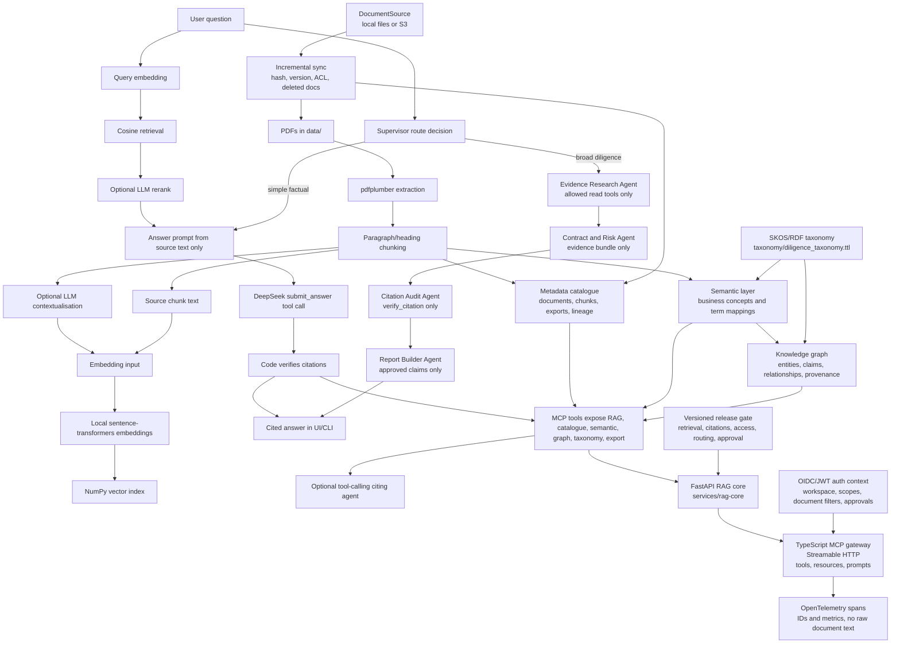

# Data Room Cited

Data Room Cited is a focused RAG prototype for commercial due diligence. It helps a consultant interrogate a small data room, get grounded answers, and see exactly where each cited claim came from.

The goal is not to automate diligence. The goal is to speed up the first pass through a data room while keeping the system honest about source coverage, missing evidence, and citation quality.

## Demo

[Watch the demo video](https://github.com/user-attachments/assets/a6287247-a55b-4740-93e6-9a4957c42f48)

## How To Run

The opt-in voice feature (M0–M3) adds a React conversation UI, synthetic read-only
gateway and local session/evidence API. Try the scripted demo with Node 22.12+ and
pnpm, without credentials or microphone access:

```powershell
pnpm install --frozen-lockfile
pnpm voice:mock
```

Open `http://127.0.0.1:5173`, select a scenario and choose **Start mock demo**.
Verification is explicitly simulated in this mode. See [setup and security boundaries](docs/voice-agent-setup.md),
[demo scenarios](docs/voice-demo-script.md) and [M3 results and limitations](docs/voice-m3-report.md).
`pnpm voice:test` runs credential-free API/UI tests; `pnpm voice:test:e2e` runs
mocked browser acceptance tests after installing Playwright Chromium. The API
contract tests also need the Python environment below. Live provider wiring and
spoken acceptance remain M4 work. Existing Streamlit workflows follow below.

M4's [local preparation and approval package](docs/voice-m4-approval.md) is ready
for review: an inactive, expiring MCP ingress guard, sandbox agent templates and
synthetic acceptance cases. No tunnel or external agent setup has been activated;
see [actual M4 preparation results](docs/voice-m4-report.md).

Prerequisites:

- Windows PowerShell
- Python 3.11+ available for creating the virtual environment
- Node.js 20+ and pnpm if you want to run the TypeScript Streamable HTTP MCP gateway
- A DeepSeek API key
- Local PDF files placed in `data/`. The public repo keeps this folder empty and ignores `data/*.pdf`.

Create and activate the local environment:

```powershell
python -m venv .venv
.\.venv\Scripts\pip.exe install -r requirements.txt
```

Create `.env` from `.env.example`, then paste your key:

```env
DEEPSEEK_API_KEY=your_key_here
```

Smoke test DeepSeek:

```powershell
.\.venv\Scripts\python.exe scripts\smoke_deepseek.py
```

Build the local vector index without ingest-time contextualisation:

```powershell
.\.venv\Scripts\python.exe scripts\build_index.py --no-contextualize
```

Build the index with contextualisation:

```powershell
.\.venv\Scripts\python.exe scripts\build_index.py --contextualize
```

The same build step also refreshes the local metadata catalogue, semantic index, and knowledge graph in `index/`.

Run the small data-management eval harness:

```powershell
.\.venv\Scripts\python.exe scripts\evaluate_data_management.py
```

Run the release gate in CI-safe fixture mode:

```powershell
.\.venv\Scripts\python.exe scripts\evaluate_release_gate.py --fixture --skip-external-gates
```

Run the release gate against the local private data-room index:

```powershell
.\.venv\Scripts\python.exe scripts\evaluate_release_gate.py --skip-external-gates
```

The full release gate is the Python release gate plus the TypeScript MCP contract test. The contract test generates a sanitized fixture index, starts the Python FastAPI core, and fails if the TypeScript MCP gateway no longer matches the Python API contract:

```powershell
pnpm --filter @data-room-cited/mcp-server test
.\.venv\Scripts\python.exe scripts\evaluate_release_gate.py --fixture --mcp-contract-passed
```

Sync documents from the configured source into `data/`:

```powershell
.\.venv\Scripts\python.exe scripts\sync_document_source.py
```

For S3, set `DOCUMENT_SOURCE_TYPE=s3`, `S3_SOURCE_BUCKET`, and optionally `S3_SOURCE_PREFIX` / `S3_ENDPOINT_URL`. Then run:

```powershell
.\.venv\Scripts\python.exe scripts\sync_document_source.py --rebuild-index --no-contextualize
```

Ask from the CLI:

```powershell
.\.venv\Scripts\python.exe scripts\ask.py "What are the key contracts?"
```

Ask through the tool-calling citing agent:

```powershell
.\.venv\Scripts\python.exe scripts\agent_ask.py "What contract risks should I cite?"
```

Route automatically between deterministic RAG and the multi-agent diligence workflow:

```powershell
.\.venv\Scripts\python.exe scripts\agent_ask.py "Who is covering the CTO role?" --workflow auto
.\.venv\Scripts\python.exe scripts\agent_ask.py "Assess customer concentration and contract renewal risks across the data room." --workflow multi-agent
```

Run the MCP server over stdio for an MCP-compatible client:

```powershell
.\.venv\Scripts\python.exe scripts\mcp_server.py
```

Validate the MCP server with MCP Inspector. On a machine with Node/npm on PATH, use:

```powershell
npx @modelcontextprotocol/inspector --cli .\.venv\Scripts\python.exe scripts\mcp_server.py --method tools/list --format json
```

In this workspace, global `npx` was not available, so the tested command used `pnpm dlx` with Node on `PATH`:

```powershell
pnpm dlx @modelcontextprotocol/inspector --cli .\.venv\Scripts\python.exe scripts\mcp_server.py --method tools/list --format json
```

For `search_data_room`, the Inspector smoke test below uses `semantic=false` so the one-shot MCP process does not spend the request window cold-loading the local embedding model. The app and agent still use semantic retrieval by default.

Run the Python RAG core as an internal FastAPI service:

```powershell
.\.venv\Scripts\python.exe -m uvicorn app:app --app-dir services\rag-core --host 127.0.0.1 --port 8765
```

Install and run the TypeScript MCP gateway over Streamable HTTP:

```powershell
pnpm install
$env:RAG_CORE_BASE_URL = "http://127.0.0.1:8765"
pnpm --filter @data-room-cited/mcp-server dev
```

The HTTP MCP endpoint is:

```text
http://127.0.0.1:8787/mcp
```

Validate the TypeScript gateway with MCP Inspector:

```powershell
pnpm dlx @modelcontextprotocol/inspector --cli http://127.0.0.1:8787/mcp --method tools/list --format json
pnpm dlx @modelcontextprotocol/inspector --cli http://127.0.0.1:8787/mcp --method tools/call --tool-name search_data_room --tool-arg query="contract risks" --tool-arg top_k=2 --tool-arg semantic=false --format json
pnpm dlx @modelcontextprotocol/inspector --cli http://127.0.0.1:8787/mcp --method resources/read --uri "dataroom://chunks/01_Meridian_Analytics_Company_Overview-0001" --format json
pnpm dlx @modelcontextprotocol/inspector --cli http://127.0.0.1:8787/mcp --method prompts/list --format json
```

Run the TypeScript gateway contract tests:

```powershell
pnpm --filter @data-room-cited/mcp-server build
pnpm --filter @data-room-cited/mcp-server test
```

Run the gateway with JWT authentication enabled:

```powershell
$env:MCP_AUTH_REQUIRED = "true"
$env:MCP_ALLOW_DEV_TOKENS = "false"
$env:MCP_AUTH_ISSUER = "data-room-cited-local"
$env:MCP_AUTH_AUDIENCE = "http://127.0.0.1:8787/mcp"
$env:MCP_DEV_JWT_SECRET = "local-dev-only-change-me"

$tokenLines = @(pnpm --filter @data-room-cited/mcp-server mint-token -- --scope "documents:read citations:verify" --workspace "deal-alpha" --documents "01_Meridian_Analytics_Company_Overview.pdf")
$token = $tokenLines[$tokenLines.Length - 1]

pnpm --filter @data-room-cited/mcp-server dev
```

Then call Inspector with the bearer token:

```powershell
pnpm dlx @modelcontextprotocol/inspector --cli --transport http --server-url http://127.0.0.1:8787/mcp --header "Authorization: Bearer $token" --method tools/call --tool-name search_data_room --tool-arg query="contract risks" --tool-arg top_k=2 --tool-arg semantic=false --format json
```

Run the local production scaffold:

```powershell
docker compose up --build
```

Run the Streamlit UI:

```powershell
.\.venv\Scripts\streamlit.exe run app.py
```

Open:

```text
http://localhost:8501
```

Consultant stress-test prompts are in [`docs/consultant_stress_tests.md`](docs/consultant_stress_tests.md).

## What It Does

1. Loads configuration from `.env` through `src/config.py`.
2. Reads PDFs from `data/` using `pdfplumber`.
3. Splits extracted text into paragraph/heading-aware chunks with page ranges and section titles.
4. Optionally asks DeepSeek to generate short retrieval-only context for each chunk at ingest time.
5. Embeds `chunk.context + chunk.text` when context exists; otherwise embeds `chunk.text`.
6. Stores chunks and embeddings in `index/chunks.json` and `index/embeddings.npy`.
7. At question time, embeds the user query locally with `BAAI/bge-small-en-v1.5`.
8. Retrieves candidate chunks with in-memory NumPy dot-product search over normalized vectors.
9. Optionally reranks candidates with DeepSeek, with graceful fallback to cosine retrieval.
10. For broad consultant questions, such as summaries, risks, missing information, inconsistencies, presentations, or readouts, uses the whole extracted corpus instead of only top-k retrieval.
11. Builds an answer prompt from source chunk text only, never generated context.
12. Forces DeepSeek to return a structured `submit_answer` function call.
13. Verifies every citation against retrieved `chunk.text` using whitespace-normalized, case-sensitive quote matching.
14. Retries once if citations fail and the answer is not already `insufficient`.
15. Displays citations with document, page range, section title, chunk ID, and quote.
16. Exposes retrieval, chunk inspection, citation verification, document coverage, rebuild, and export capabilities as MCP tools.
17. Provides an optional tool-calling citing agent that can call those tools before answering.
18. Builds a lightweight metadata catalogue for documents, chunks, exports, ownership placeholders, classification, sensitivity, quality status, and lineage.
19. Builds a semantic layer that maps source terms such as "customer", "ARR", and "termination" to canonical diligence concepts.
20. Builds a local NetworkX-backed knowledge graph with entities, concepts, claims, relationships, and source provenance.
21. Imports a small SKOS/Turtle taxonomy so controlled vocabulary resolution is testable without claiming a production PoolParty implementation.
22. Exposes catalogue, semantic, graph, taxonomy, and data-quality operations as MCP tools.
23. Includes a small deterministic eval harness for entity resolution, taxonomy resolution, graph search, and provenance checks.
24. Wraps trusted Python capabilities behind `services/rag-core` FastAPI endpoints.
25. Exposes a TypeScript MCP gateway over Streamable HTTP with tools, resources, prompts, Zod validation, simple scopes, and contract tests.
26. Routes simple factual questions to the lower-cost deterministic RAG path.
27. Routes broad diligence questions to a multi-agent workflow with separate research, risk-analysis, citation-audit, and report-builder agents.
28. Captures a trace of agent decisions, model calls, tool calls, fallbacks, budgets, and deterministic release-gate actions.
29. Supports authenticated Streamable HTTP MCP with JWT validation, local dev tokens, workspace identity, simple scopes, approval grants, and document-level filters.
30. Derives tenant, user, document access, and write approvals from the authenticated context rather than from LLM-generated tool arguments.
31. Emits OpenTelemetry span hooks across routing, subagent calls, MCP tools, retrieval, reranking, citation verification, LLM generation, approvals, and exports.
32. Includes Docker Compose services for the web app, Python RAG core, orchestrator, TypeScript MCP gateway, and an OpenTelemetry collector.
33. Includes CI scaffolding for Python tests, TypeScript lint/typecheck/tests, MCP contract tests, container builds, and dependency/security checks.
34. Runs a versioned release gate over retrieval hit@5, citation validity, claim support, cross-document evidence, abstention, contradiction evidence, prompt injection, access isolation, safe tool failure, routing, and human approval.
35. Supports a real `DocumentSource` connector boundary with local-file and S3 implementations, incremental cursors, content hash/version tracking, source ACL metadata, deleted-document handling, idempotent sync, and catalogue lineage.



## Key Decisions

- **Use DeepSeek directly instead of AWS Bedrock or APIs from Claude, OpenAI, or Gemini.** Bedrock model access added unnecessary complexity for this prototype, while DeepSeek's OpenAI-compatible endpoint made the demo buildable in one evening at a much lower cost.
- **Keep embeddings local.** `sentence-transformers` with `BAAI/bge-small-en-v1.5` is enough for this tiny corpus and avoids paying an external provider for every embedding call.
- **Use a local NumPy index.** There are only a handful of PDFs. A vector database would add operational complexity without improving the demo.
- **Use contextual retrieval only at ingest.** Generated context helps search, but final answers and citation checks use source text only.
- **Prefer verified citations over fluent answers.** The LLM can synthesize, but code decides whether a citation is acceptable.
- **Keep broad diligence questions whole-corpus.** A request like "prepare a diligence presentation" should not be bottlenecked by six nearest chunks.
- **Fail soft where possible.** Context generation and reranking are enhancements. If either fails, the system still builds or answers using vanilla embeddings/cosine retrieval.
- **Surface limits loudly.** If a PDF produces zero chunks, the system warns that OCR is needed instead of silently pretending it searched the document.
- **Use MCP as a capability boundary, not a rewrite.** The original RAG pipeline stays intact. MCP exposes high-level tools such as search, chunk inspection, citation verification, document coverage, rebuild, and export so an agent or external client can reuse the same trusted functions.
- **Use a TypeScript MCP gateway for protocol fluency.** The Python core remains the source of truth; the TypeScript gateway validates arguments with Zod, enforces simple scopes, and exposes tools, resources, and prompts over Streamable HTTP.
- **Use multi-agent only where it earns its keep.** Broad diligence requests need decomposition, evidence gathering, risk synthesis, audit, and report structure. Simple factual lookups stay on deterministic RAG because multi-agent adds cost, latency, and failure modes.
- **Keep the final release gate deterministic.** The Citation Audit Agent can review support quality, but code still enforces quote verification. A claim with a failed citation check cannot enter the final multi-agent report.
- **Add enterprise data-management concepts locally first.** The catalogue, semantic layer, taxonomy import, and graph are local JSON/NetworkX artifacts. That is deliberate: it demonstrates stewardship, lineage, controlled vocabulary, and graph-backed agent tools without pretending this prototype is a deployed enterprise catalogue or PoolParty/Neo4j service.
- **Treat auth as execution context, not an LLM input.** The MCP gateway derives workspace, user, scopes, document filters, and approval grants from bearer-token claims. The model can ask for a tool call, but it cannot grant itself access by passing `tenant_id` or `access_level` as arguments.
- **Add production controls as deployable scaffolding, not a premature cloud migration.** Docker, CI, OpenTelemetry, and a reference Terraform layout show how the system would move toward enterprise operation while keeping the local demo understandable.
- **Use evals as release criteria, not demo theatre.** The release gate is versioned and deterministic first, so CI can fail on broken retrieval, citation matching, access isolation, routing, approval gates, or safe-failure behavior before anyone watches a polished demo.
- **Implement one connector well before naming many.** The connector layer now has local-file and S3 implementations behind the same `DocumentSource` interface. SharePoint can use the same shape later, but the current repo has one real enterprise-style adapter path rather than a list of aspirational integrations.

## MCP And Agent Layer

The server uses the documented Python SDK `FastMCP` API:

```python
from mcp.server.fastmcp import FastMCP
```

The validated SDK dependency is pinned as:

```text
mcp[cli]==1.30.0
```

The MCP layer turns the app's reliable internal capabilities into callable tools:

| Tool | Purpose |
|---|---|
| `list_documents` | Show PDFs in `data/` and whether each has indexed chunks |
| `search_data_room` | Run local semantic retrieval over the saved index; pass `semantic=false` for a quick lexical Inspector smoke test |
| `get_chunk` | Open one source chunk by `chunk_id` |
| `verify_citation` | Check that a quote appears in original source text for a chunk |
| `get_document_coverage` | Report indexed coverage and OCR/staleness warnings |
| `search_catalog` | Search catalogue assets by title, domain, classification, status, or chunk ID |
| `get_data_asset` | Inspect one catalogue asset |
| `get_asset_lineage` | Trace document-to-chunk-to-artifact lineage |
| `get_data_quality_status` | Summarize extraction status and data-quality warnings |
| `list_document_source_documents` | List documents visible through the configured local or S3 source |
| `sync_configured_document_source` | Sync the configured source into `data/` and optionally rebuild the index |
| `list_business_concepts` | List canonical diligence concepts and mention counts |
| `resolve_business_term` | Resolve source terminology to canonical business concepts |
| `search_by_entity` | Search semantic mentions and evidence |
| `get_entity_evidence` | Return source evidence for a concept or term |
| `search_entities` | Search graph entities, concepts, and claims |
| `get_entity_relationships` | Traverse graph relationships around an entity |
| `find_supporting_evidence` | Find claim nodes and source provenance for a topic |
| `find_conflicting_claims` | Surface heuristic contradiction candidates |
| `resolve_taxonomy_concept` | Resolve a term against the imported SKOS/Turtle taxonomy |
| `list_broader_concepts` | List broader controlled-vocabulary concepts |
| `list_related_concepts` | List related controlled-vocabulary concepts |
| `validate_entity_classification` | Validate a term against an expected taxonomy concept |
| `rebuild_index` | Rebuild chunks and embeddings from `data/*.pdf` |
| `export_powerpoint_outline` | Save a cited Markdown slide-outline artifact to `exports/` |
| `enterprise_connector_plan` | Document the planned SharePoint, Box, and CRM connector boundary |

The optional agent loop in `src/agent.py` uses DeepSeek tool calling over the same tool layer. It is intentionally separate from `src/rag.py`, so the original deterministic RAG flow remains available for the Streamlit UI and CLI.

### Multi-Agent Diligence Workflow

`src/diligence_agents.py` implements the broad-question workflow. It deliberately does not rename pipeline stages as agents; each agent has a separate prompt, state schema, tool allowlist, and responsibility.

| Agent | Responsibility | Tool access |
|---|---|---|
| Supervisor | Route simple questions to deterministic RAG and broad questions to the diligence workflow | No direct tools |
| Evidence Research Agent | Plan searches, inspect document coverage, retrieve chunks, catalogue matches, and graph evidence | `list_documents`, `get_document_coverage`, `search_data_room`, `get_chunk`, `search_catalog`, `find_supporting_evidence`, `get_entity_relationships` |
| Contract and Risk Agent | Analyze only the evidence bundle and produce candidate claims, risks, and unanswered questions | No raw tool access |
| Citation Audit Agent | Mechanically verify citations and review support quality | `verify_citation` only |
| Report Builder Agent | Build the final memo or slide-outline from approved claims only | `export_powerpoint_outline` only after explicit approval |

The workflow has explicit budgets for model calls, tool calls, retries, elapsed time, and context size. It also records an execution trace so a reviewer can see why the system routed a question, which tools were used, which subagent fell back, and which claims were rejected before release.

The tested broad-question command:

```powershell
.\.venv\Scripts\python.exe scripts\agent_ask.py "Assess customer concentration and contract renewal risks across the data room." --workflow multi-agent --hide-trace
```

returned `Route: multi_agent_diligence`. A simple factual smoke test:

```powershell
.\.venv\Scripts\python.exe scripts\agent_ask.py "Who is covering the CTO role?" --workflow auto --hide-trace
```

returned `Route: deterministic_rag`.

### TypeScript Streamable HTTP Gateway

`apps/mcp-server` uses the official TypeScript MCP SDK packages pinned in `apps/mcp-server/package.json`:

```text
@modelcontextprotocol/server@2.0.0
@modelcontextprotocol/node@2.0.0
@modelcontextprotocol/client@2.0.0
```

The gateway does not duplicate RAG logic. It calls the internal FastAPI core in `services/rag-core`, validates tool inputs and output envelopes with Zod, propagates correlation IDs, and returns typed recoverable errors instead of stack traces.

It also uses `jose` for JWT validation and OpenTelemetry SDK/exporter packages for OTLP trace export when `OTEL_EXPORTER_OTLP_ENDPOINT` is configured.

| Surface | Names |
|---|---|
| Tools | `search_data_room`, `verify_citation`, `find_supporting_evidence`, `get_asset_lineage`, `list_document_source_documents`, `sync_document_source`, `rebuild_index`, `export_powerpoint_outline` |
| Resources | `dataroom://documents/{document_id}`, `dataroom://chunks/{chunk_id}`, `dataroom://catalogue/{asset_id}`, `dataroom://evals/latest` |
| Prompts | `diligence-risk-review`, `contract-concentration-analysis`, `evidence-gap-assessment` |

Simple scopes are intentionally lightweight for the MVP. In the default local mode, no token falls back to read-only access. When `MCP_AUTH_REQUIRED=true`, a bearer token is mandatory:

| Token | Scopes |
|---|---|
| no token or `Bearer read` | `documents:read`, `citations:verify` |
| `Bearer write` | `documents:read`, `citations:verify`, `index:write`, `exports:write` |
| `Bearer admin` | all local scopes |

With `MCP_AUTH_REQUIRED=true`, the gateway validates bearer JWTs against either `MCP_JWKS_URL` or the local `MCP_DEV_JWT_SECRET` used for development. It requires a `workspace_id` or `tenant_id` claim, accepts standard `scope`/`scp` claims, supports `document_ids`/`allowed_documents` for document-level filters, and uses `approval_grants`/`approvals` for sensitive write tools such as `rebuild_index` and `export_powerpoint_outline`.

The contract tests spin up the Python FastAPI service, connect to the TypeScript MCP server in memory, and compare MCP tool output with direct Python API output for retrieval, citation verification, evidence search, and lineage. They also confirm that a read-only client cannot call `rebuild_index`.

## Enterprise Controls

The production-facing additions are intentionally small but concrete:

| Control | Implementation |
|---|---|
| Authentication | Streamable HTTP MCP gateway validates bearer JWTs, with local HS256 dev tokens and optional JWKS support |
| Workspace identity | `workspace_id` or `tenant_id` is derived from the token and attached to the access context |
| Tool authorization | Read/write/admin scopes gate MCP tools before Python is called |
| Document authorization | Allowed document IDs from the token filter search results, resources, lineage, and provenance before content reaches the caller |
| Human approval | Write tools require an approval grant in the authenticated context when `MCP_APPROVAL_REQUIRED=true` |
| Observability | OpenTelemetry spans wrap agent routing, subagent calls, MCP tool calls, retrieval, reranking, citation checks, LLM calls, index rebuilds, and exports |
| Confidentiality | Trace attributes use IDs, counts, roles, model IDs, prompt versions, and chunk IDs rather than raw confidential document text |
| Containers | Separate local containers for `web`, `rag-core`, `orchestrator`, `mcp-server`, and `otel-collector` |
| CI/CD | GitHub Actions run Python compile/tests/evals, TypeScript lint/typecheck/tests, mandatory MCP contract tests, container builds, and audit commands |
| Cloud reference | Terraform sketch for AWS ECS/Fargate, S3 document storage, CloudWatch logs, and a place to add ALB/Postgres state |

## Release Gate

`evals/release_gate_v1.json` defines the first release suite. `scripts/evaluate_release_gate.py` executes it and exits non-zero when a non-skipped gate fails.

| Gate | Threshold |
|---|---|
| Citation-string validity | `100%` |
| Unsupported factual claims | `0` |
| Restricted-document leakage | `0` |
| MCP schema/contract pass rate | `100%`, enforced by the TypeScript MCP test job |
| Retrieval hit@5 | `>= 90%` |
| Workflow completion rate | `>= 95%` |
| Write actions without approval | `0` |

The release gate records latency by suite and keeps model cost as a measured field rather than inventing budgets before benchmark data exists. The current fixture suite is deterministic and CI-safe; the same script can run against the private local index when the data-room PDFs are present. Cases can be marked fixture-only or local-only so synthetic safety checks do not falsely fail a real private index that lacks those synthetic documents.

## Document Sources

`src/document_sources.py` defines a real connector interface:

```python
class DocumentSource(Protocol):
    def list_documents(self, context: AccessContext) -> list[DocumentMetadata]: ...
    def download_document(self, document_id: str, context: AccessContext) -> BinaryIO: ...
    def get_changes(self, cursor: str | None, context: AccessContext) -> ChangeSet: ...
```

Implemented sources:

| Source | What it demonstrates |
|---|---|
| `LocalFileDocumentSource` | Local PDF discovery, SHA-256 content hashes, sidecar ACL JSON, incremental cursor, deleted-document handling, idempotent sync |
| `S3DocumentSource` | S3 bucket/prefix discovery, ETag/version tracking, object tags/metadata, ACL metadata, incremental cursor, streaming download, fake-client tests for pagination, deletes, download failure, and idempotent sync |

`scripts/sync_document_source.py` writes synced PDFs into `data/` and persists `index/source_manifest.json`. The catalogue reads that manifest so document assets carry source-system URI, version, content hash, sync timestamp, ACL metadata, and lineage into chunks and generated artifacts.

The data-management additions are intentionally modest:

- The catalogue is a local JSON snapshot in `index/catalogue.json`.
- The semantic layer is defined in `semantic/business_concepts.json` and materialized to `index/semantic_index.json`.
- The graph is built with NetworkX and persisted to `index/knowledge_graph.json`.
- The taxonomy is a small SKOS/Turtle file in `taxonomy/diligence_taxonomy.ttl`.
- Every semantic mention, graph claim, and graph relationship keeps provenance back to document, page, chunk ID, and quote where available.

### Inspector Smoke-Test Samples

Tool discovery for the Python stdio MCP server returned the registered tools. Sample subset:

```json
{
  "tools": [
    "list_documents",
    "search_data_room",
    "get_chunk",
    "verify_citation",
    "get_document_coverage",
    "list_document_source_documents",
    "sync_configured_document_source",
    "rebuild_index",
    "export_powerpoint_outline",
    "enterprise_connector_plan"
  ]
}
```

`search_data_room` was called through Inspector in quick lexical mode:

```powershell
pnpm dlx @modelcontextprotocol/inspector --cli .\.venv\Scripts\python.exe scripts\mcp_server.py --method tools/call --tool-name search_data_room --tool-arg query="contract risks" --tool-arg top_k=2 --tool-arg semantic=false --format json
```

Sample response:

```json
{
  "query": "contract risks",
  "top_k": 2,
  "mode": "lexical",
  "results": [
    {
      "chunk_id": "01_Meridian_Analytics_Company_Overview-0001",
      "source": "01_Meridian_Analytics_Company_Overview.pdf pp.1-2, 4. Customers and commercial model",
      "score": 1.0
    }
  ]
}
```

`get_chunk` was called through Inspector:

```powershell
pnpm dlx @modelcontextprotocol/inspector --cli .\.venv\Scripts\python.exe scripts\mcp_server.py --method tools/call --tool-name get_chunk --tool-arg chunk_id=04_Meridian_Key_Contracts_Summary-0000 --format json
```

Sample response:

```json
{
  "found": true,
  "chunk": {
    "chunk_id": "04_Meridian_Key_Contracts_Summary-0000",
    "source": "04_Meridian_Key_Contracts_Summary.pdf p.1, Key Contracts Summary"
  }
}
```

`verify_citation` was called through Inspector:

```powershell
pnpm dlx @modelcontextprotocol/inspector --cli .\.venv\Scripts\python.exe scripts\mcp_server.py --method tools/call --tool-name verify_citation --tool-arg chunk_id=04_Meridian_Key_Contracts_Summary-0000 --tool-arg quote="Together these account for 61% of total ARR." --format json
```

Sample response:

```json
{
  "verified": true,
  "reason": "verified",
  "chunk_id": "04_Meridian_Key_Contracts_Summary-0000",
  "source": "04_Meridian_Key_Contracts_Summary.pdf p.1, Key Contracts Summary"
}
```

Example data-management tool calls:

```powershell
pnpm dlx @modelcontextprotocol/inspector --cli .\.venv\Scripts\python.exe scripts\mcp_server.py --method tools/call --tool-name get_data_quality_status --format json
```

```powershell
pnpm dlx @modelcontextprotocol/inspector --cli .\.venv\Scripts\python.exe scripts\mcp_server.py --method tools/call --tool-name resolve_business_term --tool-arg term=ARR --format json
```

```powershell
pnpm dlx @modelcontextprotocol/inspector --cli .\.venv\Scripts\python.exe scripts\mcp_server.py --method tools/call --tool-name search_entities --tool-arg query="Folium Stores" --tool-arg limit=1 --format json
```


### TypeScript Gateway Inspector Samples

`tools/list` over Streamable HTTP returned the six TypeScript gateway tools:

```json
{
  "tools": [
    "search_data_room",
    "verify_citation",
    "find_supporting_evidence",
    "get_asset_lineage",
    "rebuild_index",
    "export_powerpoint_outline"
  ]
}
```

`verify_citation` returned a typed success envelope:

```json
{
  "ok": true,
  "data": {
    "verified": true,
    "reason": "verified",
    "chunk_id": "01_Meridian_Analytics_Company_Overview-0001",
    "source": "01_Meridian_Analytics_Company_Overview.pdf pp.1-2, 4. Customers and commercial model"
  }
}
```

`resources/read` for `dataroom://chunks/01_Meridian_Analytics_Company_Overview-0001` returned the source chunk as JSON, and `prompts/list` returned the three diligence prompts. A read-only call to `rebuild_index` returned a typed `insufficient_scope` error, as expected.

## What It Deliberately Doesn't Do

- It does not OCR image-only or scanned PDFs. If a PDF produces no extractable text, indexing logs a warning naming the file and continues with the documents that did extract.
- It does not claim to read documents that produced zero chunks.
- It does not fine-tune a model.
- It does not use a production vector database.
- It does not preserve conversational memory as structured state.
- It does not produce a finished PowerPoint file. The MCP export tool saves a Markdown PowerPoint outline that a consultant can review.
- It does not guarantee that all risks are found. It gives a grounded first-pass view over extracted text.
- It does not treat generated contextualisation as source evidence.
- It does not show the past conversations.
- It does not implement live SharePoint, Box, or CRM connectors. It implements local-file and S3 document sources first; SharePoint/Box/CRM would follow the same `DocumentSource` interface after client tenant, auth, and data-residency requirements are agreed.
- It does not implement a production enterprise catalogue, semantic platform, Neo4j deployment, or PoolParty integration. It implements local, testable versions of those patterns.
- It does not yet use LangGraph JS subgraphs. The current multi-agent workflow implements the same separation-of-responsibilities pattern inside the Python core first; LangGraph would be the next orchestration upgrade once persistence and human approvals need to be productionized.
- It does not implement a full external identity provider, production secret manager, production data residency policy, enterprise S3 bucket policy, or turnkey AWS deployment. JWT/JWKS, scopes, approvals, Docker, CI, telemetry hooks, source connectors, and Terraform are present as the next deployable boundary.


## What I Would Do Differently With More Time

1. **OCR fallback for image-only PDFs.** Render scanned pages, run OCR, and feed the extracted text into the existing chunking/indexing path.
2. **Larger model-backed eval harness before further retrieval or prompt changes.** Expand the current deterministic release gate into expected answers, citations, entity resolution, relationship extraction, provenance accuracy, and LLM-as-judge support-quality checks.
3. **Hybrid retrieval with BM25 + dense vectors.** Blend keyword retrieval with embeddings for proper nouns, section numbers, and exact financial terms.
4. **Table-aware chunking for financial and contract tables.** Preserve row/column relationships instead of relying only on flattened PDF text.
5. **Production-grade claim extraction and inconsistency detection.** Replace the current heuristic claim graph with normalized claims, contradiction scoring, and human-review workflow.
6. **UI citation panels and document coverage reporting.** Let users expand citations into surrounding source text and see which PDFs contributed chunks or need OCR.
7. **Export to memo or PowerPoint outline.** Turn verified answers into a consultant-ready Markdown memo or slide-outline artifact.
8. **Additional enterprise connectors and governed storage.** Add approved SharePoint, Box, CRM, Postgres/pgvector, and Neo4j services only after auth, tenant permissions, data residency, and audit requirements are agreed.

## Project Layout

```text
.
|-- app.py                         # Streamlit UI: Q&A plus PDF management sidebar
|-- requirements.txt
|-- package.json                   # pnpm workspace commands for the TypeScript MCP gateway
|-- pnpm-workspace.yaml
|-- tsconfig.base.json
|-- README.md
|-- .env.example
|-- .github/
|   `-- workflows/
|       `-- ci.yml                 # Python, TypeScript, MCP, container, and audit checks
|-- docker-compose.yml             # Local service topology with OpenTelemetry collector
|-- docker/
|   |-- orchestrator.Dockerfile
|   |-- rag-core.Dockerfile
|   `-- web.Dockerfile
|-- infra/
|   |-- otel-collector.yaml
|   `-- terraform/
|       `-- aws-reference/         # Reference ECS/S3/CloudWatch Terraform sketch
|-- apps/
|   `-- mcp-server/                # TypeScript Streamable HTTP MCP gateway
|       |-- Dockerfile
|       |-- package.json
|       |-- src/
|       |   |-- accessControl.ts
|       |   |-- auth.test.ts
|       |   |-- auth.ts
|       |   |-- config.ts
|       |   |-- mintDevToken.ts
|       |   |-- mcpGateway.contract.test.ts
|       |   |-- mcpServer.ts
|       |   |-- otel.ts
|       |   |-- ragCoreClient.ts
|       |   |-- schemas.ts
|       |   |-- scopes.ts
|       |   |-- server.ts
|       |   `-- telemetry.ts
|       `-- vitest.config.ts
|-- data/                          # Source PDFs
|   `-- .gitkeep                  # PDFs are local-only and ignored by Git
|-- docs/
|   `-- consultant_stress_tests.md
|-- evals/
|   |-- data_management_cases.json
|   `-- release_gate_v1.json
|-- exports/                       # Generated memo / slide-outline artifacts
|   `-- .gitkeep
|-- index/                         # Generated local index
|   |-- catalogue.json
|   |-- chunks.json
|   |-- embeddings.npy
|   |-- knowledge_graph.json
|   |-- semantic_index.json
|   `-- source_manifest.json
|-- semantic/
|   `-- business_concepts.json     # Canonical concepts and term mappings
|-- taxonomy/
|   `-- diligence_taxonomy.ttl     # Small SKOS/Turtle controlled vocabulary
|-- scripts/
|   |-- agent_ask.py               # CLI agent entrypoint with deterministic / multi-agent routing
|   |-- ask.py                     # CLI question entrypoint
|   |-- build_index.py             # CLI index builder
|   |-- evaluate_data_management.py
|   |-- evaluate_release_gate.py
|   |-- mcp_server.py              # MCP server exposing data-room tools
|   |-- smoke_deepseek.py
|   |-- smoke_embeddings.py
|   `-- sync_document_source.py
|-- services/
|   |-- orchestrator/
|   |   `-- app.py                 # FastAPI wrapper around deterministic / multi-agent routing
|   `-- rag-core/
|       `-- app.py                 # FastAPI wrapper around trusted Python functions
|-- tests/
|   |-- test_document_sources.py
|   |-- test_release_gate.py
|   `-- test_routing.py
`-- src/
    |-- agent.py                   # Optional DeepSeek tool-calling agent loop
    |-- catalogue.py               # Local metadata catalogue and lineage model
    |-- config.py                  # Single source of truth for settings
    |-- citations.py               # Shared quote/citation matching helpers
    |-- documents.py               # PDF extraction and chunking
    |-- document_sources.py         # Local-file and S3 source connectors
    |-- diligence_agents.py         # Broad-question supervisor and specialist diligence agents
    |-- embeddings.py              # Local sentence-transformers wrapper
    |-- index_builder.py           # Shared build pipeline
    |-- index_store.py             # Save/load/retrieve index
    |-- knowledge_graph.py         # NetworkX-backed graph with provenance
    |-- llm.py                     # DeepSeek calls, structured answer, rerank, verification
    |-- mcp_tools.py               # MCP-facing deterministic tool capabilities
    |-- rag.py                     # End-to-end RAG orchestration
    |-- release_gate.py             # Versioned deterministic release-gate evaluator
    |-- schemas.py                 # Pydantic data shapes
    |-- semantic.py                # Semantic concepts and evidence extraction
    |-- taxonomy.py                # SKOS/Turtle taxonomy import and lookup
    `-- telemetry.py               # Python OpenTelemetry helpers
```
