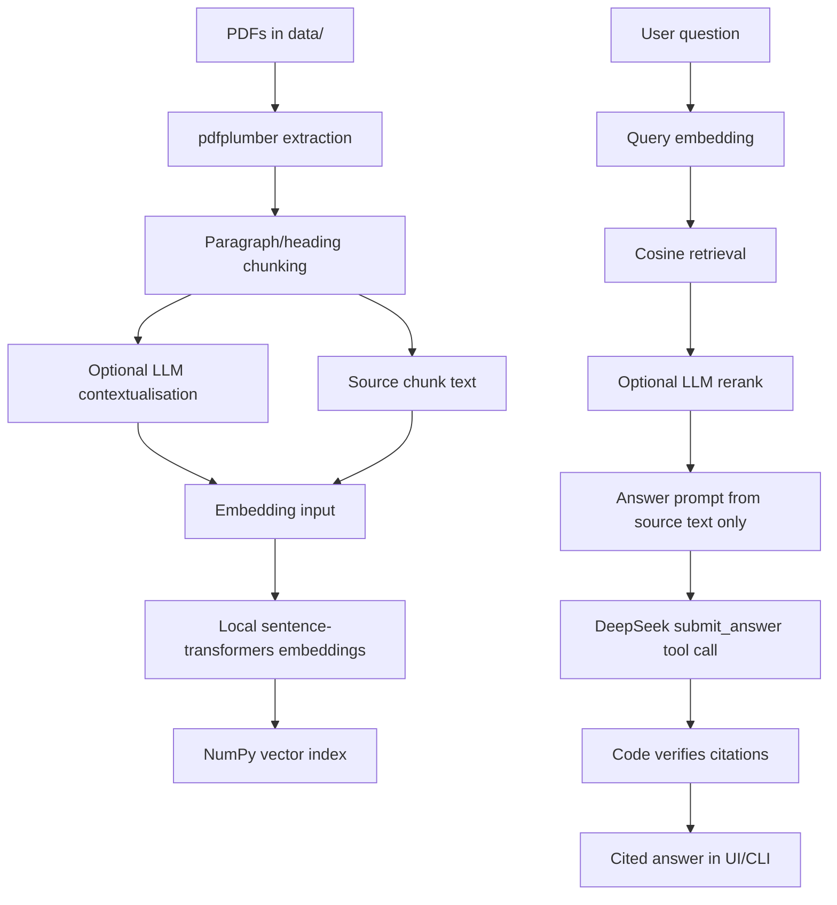

# Data Room Cited

Data Room Cited is a focused RAG prototype for commercial due diligence. It helps a consultant interrogate a small data room, get grounded answers, and see exactly where each cited claim came from.

The goal is not to automate diligence. The goal is to speed up the first pass through a data room while keeping the system honest about source coverage, missing evidence, and citation quality.

## Demo

[Watch the demo video](https://github.com/user-attachments/assets/a6287247-a55b-4740-93e6-9a4957c42f48)

## How To Run

Prerequisites:

- Windows PowerShell
- Python 3.11+ available for creating the virtual environment
- A DeepSeek API key
- Local PDF files placed in `data/`. The public repo keeps this folder empty and ignores `data/*.pdf`.

Create and activate the local environment:

```powershell
python -m venv .venv
.\.venv\Scripts\pip.exe install -r requirements.txt
```

Create `.env` from `.env.example`, then paste your key:

```env
DEEPSEEK_API_KEY=your_key_here
```

Smoke test DeepSeek:

```powershell
.\.venv\Scripts\python.exe scripts\smoke_deepseek.py
```

Build the local vector index without ingest-time contextualisation:

```powershell
.\.venv\Scripts\python.exe scripts\build_index.py --no-contextualize
```

Build the index with contextualisation:

```powershell
.\.venv\Scripts\python.exe scripts\build_index.py --contextualize
```

Ask from the CLI:

```powershell
.\.venv\Scripts\python.exe scripts\ask.py "What are the key contracts?"
```

Run the Streamlit UI:

```powershell
.\.venv\Scripts\streamlit.exe run app.py
```

Open:

```text
http://localhost:8501
```

Consultant stress-test prompts are in [`docs/consultant_stress_tests.md`](docs/consultant_stress_tests.md).

## What It Does

1. Loads configuration from `.env` through `src/config.py`.
2. Reads PDFs from `data/` using `pdfplumber`.
3. Splits extracted text into paragraph/heading-aware chunks with page ranges and section titles.
4. Optionally asks DeepSeek to generate short retrieval-only context for each chunk at ingest time.
5. Embeds `chunk.context + chunk.text` when context exists; otherwise embeds `chunk.text`.
6. Stores chunks and embeddings in `index/chunks.json` and `index/embeddings.npy`.
7. At question time, embeds the user query locally with `BAAI/bge-small-en-v1.5`.
8. Retrieves candidate chunks with in-memory NumPy dot-product search over normalized vectors.
9. Optionally reranks candidates with DeepSeek, with graceful fallback to cosine retrieval.
10. For broad consultant questions, such as summaries, risks, missing information, inconsistencies, presentations, or readouts, uses the whole extracted corpus instead of only top-k retrieval.
11. Builds an answer prompt from source chunk text only, never generated context.
12. Forces DeepSeek to return a structured `submit_answer` function call.
13. Verifies every citation against retrieved `chunk.text` using whitespace-normalized, case-sensitive quote matching.
14. Retries once if citations fail and the answer is not already `insufficient`.
15. Displays citations with document, page range, section title, chunk ID, and quote.



## Key Decisions

- **Use DeepSeek directly instead of AWS Bedrock or APIs from Claude, OpenAI, or Gemini.** Bedrock model access added unnecessary complexity for this prototype, while DeepSeek's OpenAI-compatible endpoint made the demo buildable in one evening at a much lower cost.
- **Keep embeddings local.** `sentence-transformers` with `BAAI/bge-small-en-v1.5` is enough for this tiny corpus and avoids paying an external provider for every embedding call.
- **Use a local NumPy index.** There are only a handful of PDFs. A vector database would add operational complexity without improving the demo.
- **Use contextual retrieval only at ingest.** Generated context helps search, but final answers and citation checks use source text only.
- **Prefer verified citations over fluent answers.** The LLM can synthesize, but code decides whether a citation is acceptable.
- **Keep broad diligence questions whole-corpus.** A request like "prepare a diligence presentation" should not be bottlenecked by six nearest chunks.
- **Fail soft where possible.** Context generation and reranking are enhancements. If either fails, the system still builds or answers using vanilla embeddings/cosine retrieval.
- **Surface limits loudly.** If a PDF produces zero chunks, the system warns that OCR is needed instead of silently pretending it searched the document.


## What It Deliberately Doesn't Do

- It does not OCR image-only or scanned PDFs. If a PDF produces no extractable text, indexing logs a warning naming the file and continues with the documents that did extract.
- It does not claim to read documents that produced zero chunks.
- It does not fine-tune a model.
- It does not use a production vector database.
- It does not preserve conversational memory as structured state.
- It does not produce a finished diligence report or PowerPoint file.
- It does not guarantee that all risks are found. It gives a grounded first-pass view over extracted text.
- It does not treat generated contextualisation as source evidence.
- It does not show the past conversations.


## What I Would Do Differently With More Time

1. **OCR fallback for image-only PDFs.** Render scanned pages, run OCR, and feed the extracted text into the existing chunking/indexing path.
2. **Eval harness before further retrieval or prompt changes.** Create a small set of expected answers and citations so improvements can be measured instead of judged by vibe.
3. **Hybrid retrieval with BM25 + dense vectors.** Blend keyword retrieval with embeddings for proper nouns, section numbers, and exact financial terms.
4. **Table-aware chunking for financial and contract tables.** Preserve row/column relationships instead of relying only on flattened PDF text.
5. **Claim extraction and inconsistency detection at ingest time.** Extract key claims from each document and compare them to surface contradictions or diligence follow-ups.
6. **UI citation panels and document coverage reporting.** Let users expand citations into surrounding source text and see which PDFs contributed chunks or need OCR.
7. **Export to memo or PowerPoint outline.** Turn verified answers into a consultant-ready Markdown memo or slide-outline artifact.

## Project Layout

```text
.
|-- app.py                         # Streamlit UI: Q&A plus PDF management sidebar
|-- requirements.txt
|-- README.md
|-- .env.example
|-- data/                          # Source PDFs
|   `-- .gitkeep                  # PDFs are local-only and ignored by Git
|-- docs/
|   `-- consultant_stress_tests.md
|-- index/                         # Generated local index
|   |-- chunks.json
|   `-- embeddings.npy
|-- scripts/
|   |-- ask.py                     # CLI question entrypoint
|   |-- build_index.py             # CLI index builder
|   |-- smoke_deepseek.py
|   `-- smoke_embeddings.py
`-- src/
    |-- config.py                  # Single source of truth for settings
    |-- documents.py               # PDF extraction and chunking
    |-- embeddings.py              # Local sentence-transformers wrapper
    |-- index_builder.py           # Shared build pipeline
    |-- index_store.py             # Save/load/retrieve index
    |-- llm.py                     # DeepSeek calls, structured answer, rerank, verification
    |-- rag.py                     # End-to-end RAG orchestration
    `-- schemas.py                 # Pydantic data shapes
```
