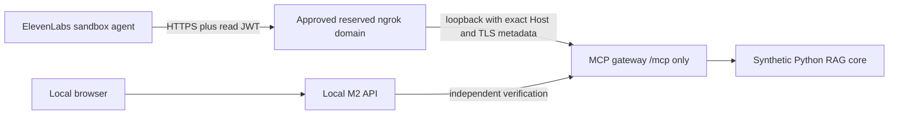

# M4 external setup: review and approval package

Status: **bounded trial approved on 20 October 2026; private sandbox agent
created and verified on 21 October; tunnel and spoken trials pending**. The
workspace name/ID mapping and exact domain have been confirmed by the user.
Workspace MCP is enabled, and the dedicated agent is archived/inactive with no
MCP server attached. No tunnel has started. See the [provider setup report](voice-m4-provider-setup-report.md)
for actual changes and readbacks. M4 remains incomplete until witnessed results
are recorded; configuration success is not live acceptance.

## Requested target and scope

Use an existing ElevenLabs development/sandbox workspace and a dedicated agent
named **Data Room Cited – M4 Voice Demo**. The approved agent has now been created
from scratch in the confirmed sandbox; nonsecret IDs are recorded in the agent
plan and live acceptance record. Clone only an explicitly identified sandbox
source after inspecting its tools, workflows and knowledge bases.
Never change a production agent. The user selected **ngrok with a reserved HTTPS
development domain**: `https://gerbil-user-hug.ngrok-free.dev`. Ownership and
transport behavior still require verification when the route is established.

The review files are:

- [Agent settings plan](voice-m4/agent-plan.json): desired settings, not an API PATCH body.
- [Prompt](voice-m4/agent-prompt.txt) and [displayEvidence parameters](voice-m4/display-evidence.schema.json).
- [Twelve synthetic evaluation cases](../evals/voice_m4_cases.json).
- [Live acceptance record](voice-m4/acceptance-results.json), currently entirely not_run.

## Approved bounded actions

| Action | Proposed scope |
|---|---|
| Install ngrok | Official Windows distribution, verify publisher/version; no service, autostart or background persistence |
| Temporary HTTPS route | User-confirmed reserved HTTPS domain to 127.0.0.1:8787, only /mcp accepted; initial window 20 minutes; inspection disabled |
| Workspace/agent setup | Confirm sandbox; enable workspace MCP only if compatible and approved; create the dedicated agent, attach only two read tools and displayEvidence |
| Agent privacy and limits | Audio saving off, one-day retention for new demo conversations only, five-minute conversation limit; no change to global Zero Retention Mode or HIPAA controls |
| Initial live trial | At most three spoken sessions, five minutes each, no automatic retry; may consume provider credits; record outcomes without raw audio/transcript logging |
| Cleanup | End sessions, stop the tunnel, clear external gateway settings, expire/revoke the demo reader credential and disable/detach the newly created demo integration |

No payment, subscription change, domain purchase, deployment, production edit or
global privacy downgrade is included. If the existing sandbox cannot use MCP under
its current privacy policy, stop and choose a compatible approved sandbox. The
workspace-wide MCP permission affects that sandbox, not just one agent.

Before applying, fill in the sandbox workspace ID/name, reserved domain and the
approved sandbox voice/model IDs. Supply provider/ngrok secrets privately through
the relevant local environment or provider secret store; never paste them into
chat, command arguments, screenshots or these files. ELEVENLABS_API_KEY remains in
the local API process. The integration receives only a short-lived synthetic
reader JWT, not the signing key. Initial preparation had no provider credentials or authenticated account access.
On 21 October, the user privately provisioned credentials and enabled the required
key scopes. Read-only workspace checks and the approved inactive-agent setup
subsequently succeeded. The remaining account check is ngrok Full Capture status.
No further approval is needed for the unchanged bounded scope above.

## Installation verified on 20 October 2026

The portable x64 CLI was downloaded from the [official Windows download page](https://ngrok.com/download/windows?tab=download)
into the ignored `.voice-demo/tools` directory. It was not added to PATH or
installed as a service. Windows Authenticode validation returned **Valid**, signed
by **ngrok, Inc.**, before execution. `ngrok version` returned **3.39.11** and
`ngrok http --help` confirmed `--url` and `--inspect` support. No tunnel command
was executed and no ngrok process remained running.

- Archive SHA-256: `699BBF1932EC43A573B764BD03E6568EFA2C4E45955EB3CC2089C19BB4BE4464`
- Executable SHA-256: `D339BCBD0713233337E860163F5249EEA679CF26750A5700510DBC241D201748`

These hashes record the downloaded artifacts; publisher verification came from
Windows signature validation. The first sandboxed signature check could not
complete; validation succeeded with normal certificate-network access before the
binary was run. No security controls were disabled.

## Local transport prepared for the approved route



The gateway continues to bind only 127.0.0.1. Blank external settings retain direct
loopback access only. Nonblank settings require voice mode, an exact HTTPS origin
and a UTC expiration no more than 30 minutes ahead. The external route accepts
only /mcp, POST/GET/DELETE, an exact configured Host, a loopback peer and a single
X-Forwarded-Proto=https value. X-Forwarded-Host, if present, must match. Duplicates,
ambiguous forwarding, query strings and unapproved Origins are rejected. Absent
Origin is permitted for service-to-service MCP; adding a present Origin requires
an explicit HTTPS allowlist value. This does not change the M2 browser Origin list.

Forwarded IPs do not establish identity. JWT signature, issuer, audience, expiry,
reader role, exact synthetic workspace/documents and read scopes remain mandatory.
The only exposed tools remain search_data_room and verify_citation. Health, session
issuance, browser UI, Streamlit, resources, prompts and write tools are not exposed
through the tunnel. The tunnel process and local OS are trusted; do not rewrite
Host to localhost or strip forwarding metadata to evade checks.

External traffic has a process-wide 120-request/minute limit and four in-flight
slots, including authentication failures. Voice JSON POST bodies are capped at
64 KiB, with malformed UTF-8/JSON and compressed bodies rejected. A 15-second
deadline bounds uploads and response streams; expiry also closes active external
responses. Evidence responses use no-store. Rejected requests close their HTTP
connection so an unread oversized body cannot interfere with the next request.
Rate limits can be exhausted by unauthenticated traffic; this is a short local
demo, not production denial-of-service protection.

## Approved operator sequence (external steps not executed)

1. Confirm the exact sandbox and reserved ngrok domain, read existing privacy/MCP
   settings, and review the proposed changes. Verify installed ngrok CLI flags
   after the approved installation. Do not rely on defaults for traffic inspection.
2. Start the approved synthetic core/gateway/API using [the M1–M3 setup](voice-agent-setup.md).
   Keep all ports on loopback. In the gateway terminal only, add the external
   settings before starting it. The following origin is an inert placeholder:

   ```powershell
   $env:VOICE_MCP_EXTERNAL_ORIGIN = "https://REPLACE-WITH-APPROVED-RESERVED-DOMAIN"
   $env:VOICE_MCP_EXTERNAL_EXPIRES_AT = [DateTime]::UtcNow.AddMinutes(20).ToString("yyyy-MM-ddTHH:mm:ss.fffZ")
   $env:VOICE_MCP_EXTERNAL_ALLOWED_ORIGINS = ""
   pnpm --filter @data-room-cited/mcp-server dev
   ```

   Use an ISO timestamp with at most three fractional digits (for example
   `2026-10-20T12:20:00.000Z`).
   Keep the gateway JWT audience equal to its existing configured local resource
   audience so M2 verification still works. The HTTPS URL routes to that same
   resource; it grants no new identity or permissions.
3. Mint a dedicated 15-minute reader token with the existing mint-token command,
   exact fixture documents and no approvals/write scopes. Keep it out of output
   and store its full `Bearer <token>` value as the integration's secret header.
   A token must expire no later than the allowed exposure window. If setup takes
   too long, stop; do not silently extend the window or renew credentials.
4. Only after tunnel approval, run the reviewed command in its own terminal:

   ```powershell
   & .\.voice-demo\tools\ngrok.exe http http://127.0.0.1:8787 --url "$env:VOICE_MCP_EXTERNAL_ORIGIN" --inspect=false
   ```

   Do not pass --host-header or add a host rewrite policy. ngrok must preserve the
   reserved Host and supply HTTPS metadata. Confirm inspection/logging is disabled
   in the applicable account configuration too; the CLI flag is not a promise
   about provider-side retention. Nothing routes to 8790, 5173 or 8501.
5. Before sending the reader secret to ElevenLabs, test the external boundary:
   /health and /api/voice/session must fail, missing/invalid JWT must fail, and
   authenticated tools/list must expose exactly two read tools. Check both JSON
   and the pinned SDK's legacy SSE responses. If routing fails, stop and inspect
   the headers; never disable Host/Origin/JWT validation.
6. After settings approval, enable MCP in the selected compatible sandbox if
   needed, create the dedicated agent, apply the reviewed prompt and signed-URL
   authentication, and register displayEvidence with **Wait for response** enabled.
   Provider UI/API shapes must be read back before proceeding. The local JSON
   Schema is a parameter contract, not a full provider API request. Runtime M2/UI
   validation additionally rejects blank and invisible-control text.
7. Add the reserved /mcp URL with Streamable HTTP transport and the reader secret.
   Select fine-grained approvals: auto-approve exactly search_data_room and
   verify_citation; disable everything else. Check discovery and agent attachments
   again. Do not import unrelated tools, knowledge bases, webhooks or workflows
   from a cloned agent. Keep API keys and the JWT signing key out of the agent.
8. Set the local API's fixed agent ID privately. Start the live UI with a five-minute
   VOICE_MAX_SESSION_MINUTES value and open localhost:5173 to match M2's configured
   Origin. The human chooses Start and microphone permission. No prerecorded or
   synthetic browser audio counts as witnessed spoken acceptance.
9. Complete the three trials below. Then End, confirm microphone release, stop
   ngrok, clear the three external gateway variables and restart in local-only
   mode. Disable/detach only the new demo integration; do not reset a shared
   workspace setting blindly or delete existing data. Confirm the external URL
   no longer reaches the gateway. Document actual cleanup results.

The first template above deliberately has no real domain, token or expiry. A
configuration file is never approval to execute these commands.

## Witnessed acceptance and current agent-testing framework

Record only observed results in acceptance-results.json. Leave unrun entries
not_run; never copy local mock successes into the live record.

| Trial | Human action and evidence required |
|---|---|
| Grounded | Ask about material customer-contract risks. Witness search/verification, a visible correct source card and a concise sourced spoken answer. Interrupt with “only 2025”; the agent must disclose the unavailable exact filter. |
| Abstention | Ask for exact net profit or the bank leverage covenant threshold. Witness an explicit coverage limitation, no invented figure and no fabricated verified card. |
| Denied/unavailable tool | Request index rebuild/export. Witness a refusal/read-only limitation and unchanged fixture fingerprint; optionally stop the core during an evidence request to observe unavailable-tool handling. |

After each trial, End must clear content and stop microphone use. Record date,
observer, success/failure, verified/rejected counts, durations and safe error codes.
Do not save audio, full transcripts, credentials or excerpt-bearing debug logs.
Provider usage and latency remain null unless actually measured. Three trials are
not a p50/p95 latency benchmark; do not invent one from mocked timings.

The current [Agent Testing framework](https://elevenlabs.io/docs/eleven-agents/customization/agent-testing)
supports simulation, next-reply and tool-call tests. After an approved test budget,
use the twelve authored cases to create those tests, then run them through the
Tests UI or the [run-tests endpoint](https://elevenlabs.io/docs/eleven-agents/api-reference/tests/run-tests).
The deprecated simulate-conversation API is not used. Tool mocks for policy tests
must be distinguished from real MCP results; provider tests cannot replace the
visible verified citation and microphone cleanup checks. No provider tests have
been created or run in this preparation phase.

## Official contracts checked on 20 October 2026

- [ElevenLabs MCP integration](https://elevenlabs.io/docs/eleven-agents/customization/tools/mcp):
  workspace-wide enablement, Streamable HTTP, secret headers and fine-grained tool
  approvals. ZRM/HIPAA restrictions must not be bypassed.
- [Authentication](https://elevenlabs.io/docs/eleven-agents/customization/authentication):
  use signed URLs; the current guide says not to combine enable_auth with a provider
  hostname allowlist. Local M2 Origin checks remain independent and enabled.
- [Client tools](https://elevenlabs.io/docs/eleven-agents/customization/tools/client-tools):
  exact case-sensitive tool name and Wait for response for validation results.
- [Retention](https://elevenlabs.io/docs/eleven-agents/customization/privacy/retention)
  and [agent settings](https://elevenlabs.io/docs/eleven-agents/api-reference/agents/update):
  proposed record_voice=false and retention_days=1 apply only to new demo data.
  This is not Zero Retention Mode or a zero-retention guarantee.
- [ngrok HTTP endpoints](https://ngrok.com/docs/gateway/endpoints/http) and
  [CLI](https://ngrok.com/docs/gateway/agent/cli): reserved --url, --inspect=false,
  TLS termination and forwarded headers. The guard deliberately rejects ambiguous
  scheme chains instead of trusting caller-supplied values.
- [Cloudflare Quick Tunnels](https://developers.cloudflare.com/tunnel/get-started/quick-tunnels/)
  lack SSE support; they were not selected for the SDK's legacy response path.
